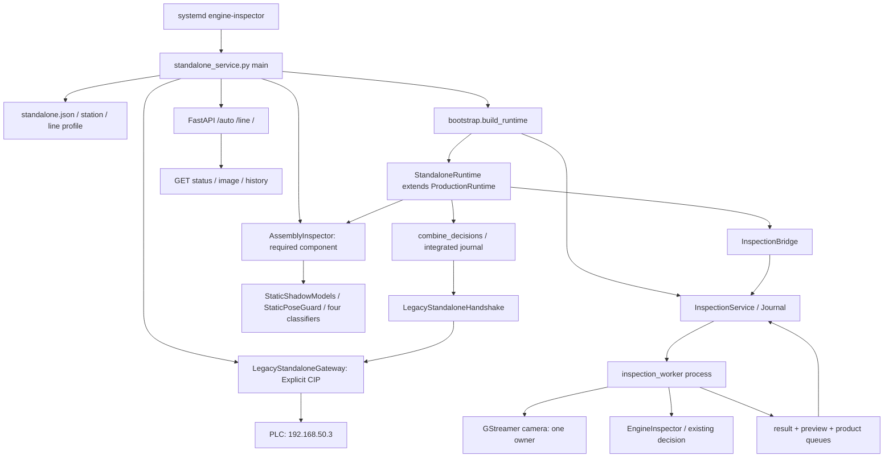

# C. 실제 프로그램 구조

이 그림은 연결된 코드 경로다. 현재는 FAULT와 writes=false 때문에 전체 사이클 실행 성공을 의미하지 않는다.

## 초기화 순서

`standalone_service.main` → config·mode 확인 → `launch_live.check_files`/release·package·frozen asset 검증 → fcntl 단일 소유자 lock/port 확인 → Legacy gateway 및 AssemblyInspector → `bootstrap.build_runtime(mode='production', standalone_profile=…, assembly=…)` → `InspectionService` spawn/Journal → `StandaloneRuntime` → `create_integrated_app`/`configure_line_web` → uvicorn foreground.

브라우저는 카메라/추론 루프 소유자가 아니다. `_run` thread가 request·관찰·결과를 처리한다. PLC 상태 polling은 약0.1초 간격으로 설정되어 있고 루프 wait는0.02초다. 이는 설정값이며 실측 응답 지연이 아니다. 정상 heartbeat와 정지 처리를 소스상 분리하려는 구조지만 현재 legacy는 정지/heartbeat 태그 자체가 없다.

|기능|소유자/파일|현재 근거|
|---|---|---|
|카메라 수신/preview|inspection_worker.worker_main / GStreamerCamera|VERIFIED_RUNTIME: 새 preview|
|제품 envelope 검출|EngineInspector.observe_product|VERIFIED_RUNTIME: 현재 관측 packet|
|제품 추적|VisionRuntimeCoordinator / SingleActiveTracker|활성 코드·과거 Track1 상태 관측. FAULT 후 최신 추적 진행 성공은 NOT_VERIFIED|
|기존 full 검사|EngineInspector.detect / assess_dynamic|VERIFIED_SOURCE_ONLY: 이번 request 검사 없음|
|3새프레임|FreshFrameSelector / worker_main|VERIFIED_SOURCE_ONLY; preview FPS와 검사 FPS 다름|
|조립 상태·정렬|AssemblyInspector → frozen StaticShadowModels|로딩 ready VERIFIED_RUNTIME; 새 추론 NOT_VERIFIED|
|결합 최종 판단|combine_decisions BOTH_REQUIRED_V1|VERIFIED_SOURCE_ONLY; shadow-only 아님|
|durable 저장|Journal.finish / service_state integrated_decision|Journal OPEN 관측; 이번 새 결과 저장 NOT_VERIFIED|
|PLC 결과|LegacyStandaloneHandshake → OmronCipGateway|코드 있음, 현재 비활성/오류|
|V3 / V2 확장 계약|standalone_plc.py / plc_v2.py|INCLUDED, 현재 선택 안 됨|
|수동/모의 기능|lab_port/mock_port/inspection_api|INCLUDED, POST 경로 현재 차단|
|OpENer→Python|없음|NOT_IMPLEMENTED|

`runtime_source/frozen_assembly`는 실제 별도 asset source 경로에서 취득했다. master나 laptop `shadow_misassembly`를 실제 로딩본으로 대신하지 않았다. 원본 weights/reference는 제외하고 release manifest의 해시만 남겼다.

모든 함수/줄번호/API 인덱스: [SYMBOL_INDEX](../manifests/SYMBOL_INDEX.json). 구조를 재현할 때 이 snapshot을 먼저 보고, 원래 공개 master는 비교 자료로 사용한다.
