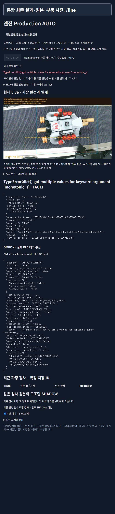
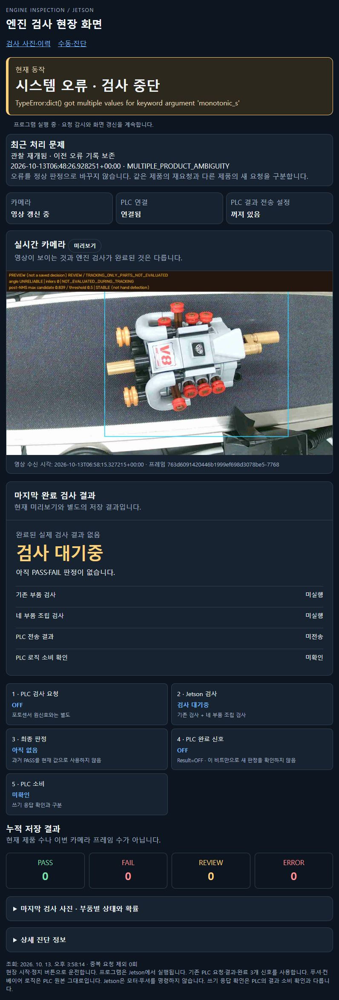
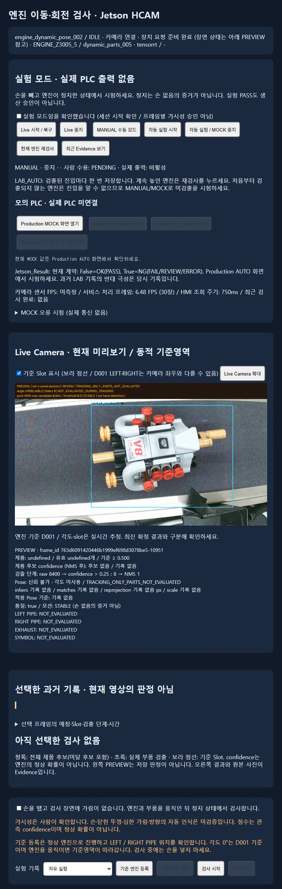

# B. UI → API → Python

실제 브라우저 GET 조회와 DOM 버튼 상태를 확인했다. START/STOP/검사/설정/PLC 발행 POST를 호출하지 않았다.

## /auto — 우선 조사 화면

상단 `/line` 링크, 운전 흐름 안내, AUTO 제어, 카메라 preview, 진단 촬영, 영역 유지보수, runtime JSON, PLC JSON, 최근 확정 검사, 조립 검사 evidence, 선택 frame 진단으로 구성된다.

|UI|API|Python 연결|현재 실제 상태 / 검사 수준|
|---|---|---|---|
|상태·Track·PLC·최근 결과|GET /api/v1/runtime/status|integration_api.status → StandaloneRuntime.status → ProductionRuntime.status|VERIFIED_RUNTIME. FAULT, RESYNC_REQUIRED, 쓰기 false|
|실시간 영상·slot 표시|GET /api/v1/preview.jpg?slots=…|inspection_api.preview → service.preview|VERIFIED_RUNTIME. 새 frame 갱신, 저장 결과 아님|
|AUTO START|POST /api/v1/runtime/auto/start|runtime.start_auto|DOM hidden/disabled. Standalone 구현 자체도 물리 시작 주체 오류를 발생시킴|
|AUTO STOP|POST /api/v1/runtime/auto/stop|runtime.stop_auto|DOM disabled; 실제 장치 STOP 검증 아님|
|3초 뒤 촬영 시작 / 저장 종료|POST /api/v1/diagnostics/capture/start, /stop|service.diagnostic_capture.start/stop|DOM 버튼 활성처럼 보이지만 standalone middleware에서 POST 차단: VERIFIED_SOURCE_ONLY|
|표시 영역 저장|POST /api/v1/runtime/production/zone|runtime.configure_zone|동일 POST 차단; 누르지 않음|
|빈 화면 Track 복구|POST /api/v1/runtime/auto/recover-empty-area|runtime.recover_empty_area|동일 POST 차단; 누르지 않음|
|MOCK request/resync/fault|POST /api/v1/runtime/production/mock/{action}|runtime.mock_action|현재 실제 PLC 모드에서 hidden|
|선택한 저장 검사|GET /api/v1/inspections/{id}, /api/v1/assets/{id}|journal.detail/asset|현재 AUTO 결과 없음. 기존 기록을 새 검사로 주장하지 않음|
|조립 결과·raw/canonical/crops|GET /api/v1/runtime/shadow/{id} 및 /images/{name}|runtime.shadow=AssemblyInspector → evidence_path|소스 경로 확인. 이번 신규 검사/사진 생성은 하지 않음|

## /line — 현장 요약

현재 동작, 최근 문제, 카메라/PLC/전송 설정, 영상, 마지막 완료 결과, 5단계 요청·검사·판정·Done·소비, 누적 저장 수, 사진/확률 상세를 제공한다. `line_hmi.html`이 GET `/api/v1/line/view`를 조회하고 `standalone_web.line_view`가 runtime을 표현한다. 결과 상세는 GET `/api/v1/line/final/{id}` → journal의 `integrated_decision:{id}`이다. 물리 구동 버튼은 없다.

관측: 시스템 오류·검사 중단 / 영상 갱신 / PLC 연결 / 전송 꺼짐 / 검사 대기중 / 완료 결과 없음. “검사 대기중”은 PASS가 아니다. PLC 소비 미확인을 명시한다.

## / — 기존 수동·진단

`inspection.html` + `inspection_lab.js` + `inspection_details.js`. 하위 서비스 IDLE/ready를 표시하며 상위 runtime FAULT와 다르게 보일 수 있다.

|기능|API와 함수|
|---|---|
|현재 상태|GET /api/v1/cell/status → InspectionService.status|
|Live 시작/중지|POST /api/v1/live/{action} → service.live_control|
|MANUAL/LAB_AUTO, 재검사, 모의 PLC|POST /api/v1/lab/{action} → service.lab_action|
|검사/기준 등록|POST /api/v1/request-identity → allocate_request 후 POST /api/v1/inspection-jobs → submit|
|취소/기준 확인|POST /api/v1/inspections/{id}/cancel → cancel; /calibrations/{id}/confirm → confirm_calibration|
|이력 조회/사진|GET /api/v1/inspections, /{id}, /api/v1/assets/{id} → Journal 조회|
|패키지 조회/전환|GET /api/v1/packages; POST /api/v1/packages/activate → activate|

여러 조작 버튼이 활성처럼 보여도 현재 서비스의 `configure_line_web` middleware는 **GET/HEAD 이외 모두 403 PHYSICAL_BUTTONS_ONLY_IN_STANDALONE_MODE**로 막는다. 실제 POST 시험은 금지 범위라 실행하지 않았고 코드만 확인했다. 화면 확대·상세 접기·조회는 읽기/표시 기능이다. 원본 검사 이력을 내보내지 않았다.

## 표시와 backend 불일치

1. `/auto`가 `계약 v3 · cycle undefined · PLC ACK null`로 표시하지만 JSON/실행 클래스는 LEGACY_THREE_BOOL이다.
2. “SHADOW, PLC 결과를 변경하지 않음” 정적 문구와 REQUIRED_FINAL_COMPONENT 실제 정책이 충돌한다.
3. `/line`의 “관찰 재개됨”은 issue.active=false에서 나온다. 오류가 `_reset_unbound_observation` 전에 발생했으므로 복구 완료 근거가 아니다.
4. `/api/v1/release`는 writes=true지만 runtime/status와 실제 config는 false다. `launch_live.check_files(plc_bench=True)`의 정적 identity가 쓰기 허용과 혼동된 결과다.
5. 유지보수의 “FAIL/REVIEW/ERROR=NG” 안내는 실제 LegacyStandaloneHandshake가 REVIEW/ERROR를 NOT_SENT로 보류하는 동작과 다르다.

DOM 기록: [AUTO 버튼](../manifests/auto_buttons.json), [유지보수 버튼](../manifests/maintenance_buttons.json). 활성 DOM, API 접근 허용, 현장 동작 성공은 각각 구분해야 한다.
